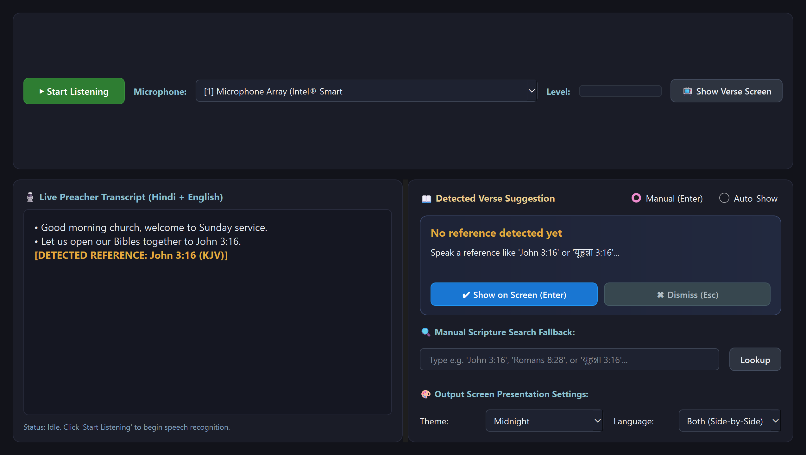
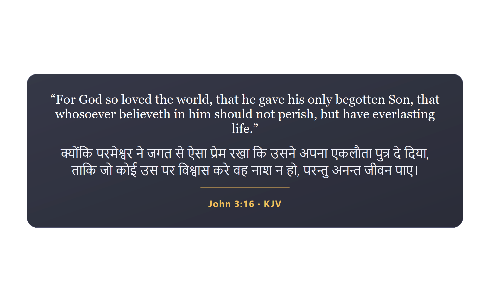

# Vachan (वचन)

> **Real-time Live Church Streaming Desktop Application**
> Automatically listens to preacher speech in Hindi, English, and Hinglish, detects Bible verse citations on the fly, and presents verses on screen for live church broadcasts.

---

## 📸 Screenshots

| Operator Control Dashboard | Centered Verse Output Screen (Wirecast / Monitor 2) |
| :---: | :---: |
|  |  |

---

## ⚡ Quick Start (1-Click Run on Windows)

Simply double-click **`run.bat`** in the project folder, or run:
```cmd
run.bat
```
This script automatically checks Python, activates the environment, ensures the local offline Bible database is initialized, and opens the application.

Or run manually:
```cmd
python main.py
```

---

## 🎙 How to Use the App

1. **Start Listening**: Click the green **`▶ Start Listening`** button on the top toolbar.
2. **Microphone**:
   - The app defaults to your active microphone (e.g. `[1] Microphone Array (Intel Smart Sound Technology)`).
   - You can switch microphones anytime using the top dropdown. The level meter confirms audio pickup.
3. **Speak into the Mic**:
   - Speak naturally in English, Hindi, or Hinglish:
     - *"Let us open our Bibles to John 3:16."*
     - *"यूहन्ना 3:16 निकालिए"*
     - *"Romans ke aath adhyay mein 28 pad dekhenge"*
     - *"Turn to Matthew chapter five verse seven"*
4. **Approve or Dismiss**:
   - When a reference is recognized, the candidate verse card highlights in the right pane.
   - Press **`Enter`** (or click **`Show on Screen`**) to push the verse live.
   - Press **`Esc`** (or click **`Dismiss`**) to discard the suggestion.
   - **Auto-Show Mode**: Toggle from *Manual* to *Auto-Show* to display high-confidence verses automatically without operator clicks.
5. **Follow-Up Verses**:
   - If the preacher says *"Now look at the next verse"*, *"previous verse"*, or *"verse 17"*, Vachan automatically resolves the relative reference against the last presented context.
6. **Manual Scripture Search**:
   - If audio was noisy or the reference wasn't spoken clearly, type into the manual fallback search box (e.g. `John 3:16` or `रोमियों 8:28`) and hit Enter.

---

## 📺 Connecting to Wirecast (Live Stream Output)

Vachan provides a dedicated borderless **Verse Output Window**:

1. **Second Monitor Presentation**:
   - Drag the Verse Window to your projector or secondary streaming monitor.
   - Press **`F11`** to toggle full-screen display.
2. **Wirecast Window Capture**:
   - In Wirecast, click **`+`** on any Master Layer and choose **`Screen Capture`** or **`Window Capture`**.
   - Select **`Vachan - Verse Output Screen`**.
   - If you want a chroma-key overlay, switch the in-app theme dropdown to **`Green Screen (Chroma)`** and apply Wirecast's Chroma Key filter.
   - If you prefer a native dark glass overlay, select the **`Midnight`** or **`Royal Blue`** theme.
3. **Language Display Modes**:
   - Use the language selector to switch between:
     - **Both (Side-by-Side / Stacked)**: English and Devanagari Hindi together.
     - **English Only**: Clean English scripture.
     - **Hindi Only**: Clean Devanagari Hindi scripture.

---

## 📖 Offline Bible Database & Licensing

Vachan works **100% offline with zero internet and no API keys required**:
- Run `python scripts\download_bibles.py` to rebuild or inspect the database in `data/bibles/vachan_bibles.db`.
- **Included Offline Translations**:
  - **KJV** (King James Version) — Public Domain worldwide.
  - **WEB** (World English Bible) — Dedicated to Public Domain (CC0).
  - **ASV** (American Standard Version) — Public Domain.
  - **HIN_IRV** (Indian Revised Version Hindi) — Open scripture distribution.
- **Copyrighted Translations (ESV, NIV, NLT)**:
  - Copyrighted modern translations are **NOT** bundled offline to ensure full legal compliance.
  - If a preacher quotes an unavailable version without an API key, the system clearly notifies the operator and displays the equivalent verse in public-domain KJV or WEB.

---

## 🛠 Hardware & Acceleration Note

- **Target GPU**: NVIDIA GeForce RTX 5060 (Blackwell Architecture, requires CUDA 12.8+).
- **GPU Check**: Run `python scripts\check_gpu.py` to inspect your CUDA and PyTorch driver versions.
- **Automatic Fallback**: If CUDA is not detected, Vachan automatically switches to CPU `int8` with 4 worker threads so you never experience crashes.

---

## 🧪 Testing

```cmd
# Run complete test suite (44 unit tests)
python -m pytest -v

# Run interactive parser showcase
python scripts\demo_parser.py
```
