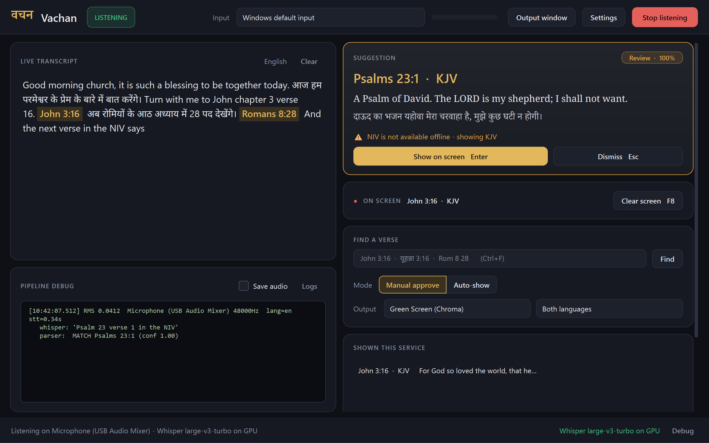
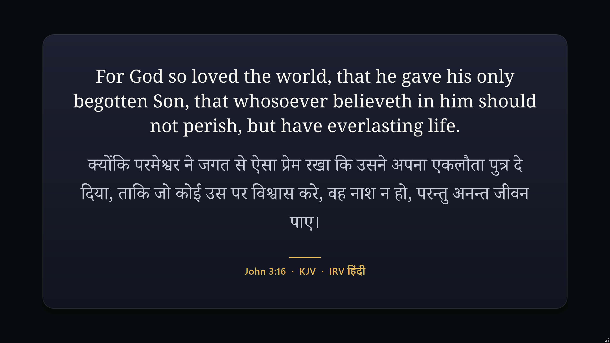

# Vachan (वचन)

Vachan listens to a sermon in **Hindi, English or Hinglish**, recognises Bible references
("Turn to John chapter 3 verse 16", "यूहन्ना 3 अध्याय 16 पद", "Romans ke aath adhyay mein 28 pad"),
and shows the verse on a clean broadcast card that Wirecast (or OBS/vMix) captures.
Everything runs offline after the first start.

| Operator window | Output (Midnight theme) |
| :---: | :---: |
|  |  |

More: [Parchment / Hindi only](docs/screenshots/output_parchment_secondary_100.png) ·
[Royal Blue / English only](docs/screenshots/output_royal_primary_100.png) ·
[Green screen](docs/screenshots/output_green_both_100.png) ·
[125 %](docs/screenshots/control_125.png) · [150 %](docs/screenshots/control_150.png)

## Quick start (Windows 10/11)

1. Install **Python 3.11** from python.org (tick *Add python.exe to PATH*). 3.12/3.13 also work.
2. Install the latest **NVIDIA driver** (RTX 50xx needs a driver with CUDA 12.8+).
3. Double-click **`run.bat`**.

The first run creates `venv\`, installs the pinned packages (plus about 1 GB of CUDA libraries
if an NVIDIA GPU is present), downloads the Bible texts (~20 MB) and, on first Start, the
Whisper model (large-v3-turbo ≈ 1.6 GB on an NVIDIA or Intel Arc GPU, small ≈ 480 MB on CPU).
On a PC without NVIDIA, `run.bat` also installs OpenVINO so an Intel Arc integrated GPU is used.
Later runs start in seconds.

## Using it during a service

1. Pick the **Input** (the mixer / USB audio interface) at the top. The meter must move when someone speaks.
2. Press **Start listening** (F5). The footer shows the profile and engine, e.g.
   `accurate · Whisper large-v3-turbo on NVIDIA GPU` (green) or the CPU fallback reason (amber), and
   `delay 1.8 s`: the measured time from the end of a phrase to the suggestion.
   Settings → **Speed profile**: *Automatic* picks the best for the PC (benchmarks: docs/BENCHMARKS.md).
3. When a reference is heard, the **Suggestion** card shows the verse, a confidence badge and any warnings
   (e.g. "NIV is not available offline - showing KJV", "Book name guessed"). Press **Enter** to put it on
   screen, **Esc** to dismiss.
4. "Next verse", "अगला पद", "verse 17", "chapter 4 verse 1" work relative to the verse on screen.
5. **Find a verse** (Ctrl+F): type `John 3:16`, `Jn 3 16`, `यूहन्ना ३:१६`, then Enter → suggestion card → Enter to show.
6. **Clear screen** (F8) blanks the output. **Shown this service** lists everything shown; double-click to reload.

Mode **Manual approve** is the default and recommended: a wrong verse on a live stream is worse than none.
**Auto-show** only shows suggestions with ≥ 90 % confidence and no warnings.

| Key | Action |
|---|---|
| Enter / Esc | Show / dismiss suggestion |
| F5 | Start / stop listening |
| F8 | Clear output |
| F9 | Show / hide output window |
| Ctrl+F | Find a verse |
| F11 or double-click (output window) | Fullscreen on the monitor it is on; Esc leaves fullscreen |
| Right-click (output window) | 1280×720 / 1920×1080 / fullscreen / hide |

## Wirecast setup

1. Start Vachan; the **Vachan - Verse Output** window opens (borderless, 1280×720).
   Right-click it → *Window 1920 x 1080* to match your canvas.
2. Wirecast → **+** on a layer → **Window Capture** (Windows: *Desktop Presenter / Screen Capture* →
   choose window) → select **Vachan - Verse Output**.
3. Full-screen card: use Midnight / Royal Blue / Parchment as a normal shot.
   Overlay on camera: choose **Green Screen (Chroma)** in *Output*, then in Wirecast add **Chroma Key**
   (green) to that shot. The card has no shadow in this theme so keying stays clean.
4. Keep the output window un-minimised (Windows does not render minimised windows). It may sit behind
   other windows or on a second monitor.

## Offline Bible texts

Built by `scripts\download_bibles.py` from [eBible.org](https://ebible.org) into
`data\bibles\vachan_bibles.db` (indexed SQLite, lookups < 1 ms):

| Code | Translation | License |
|---|---|---|
| KJV | King James Version | Public Domain |
| ASV | American Standard Version (1901) | Public Domain |
| WEB | World English Bible | Public Domain |
| HIN_IRV | Hindi Indian Revised Version | CC BY-SA 4.0, © 2017-2019 Bridge Connectivity Solutions |

ESV, NIV, NLT, NKJV, NASB and the Hindi O.V. (BSI) are copyrighted and **not bundled**. If the preacher
names one, the suggestion uses KJV and says so. Verses that a translation omits (e.g. Acts 8:37 in WEB)
also fall back to KJV with a notice. Main/second translation are set in **Settings**.

Fonts: Noto Serif, Noto Serif/Sans Devanagari (SIL Open Font License, `assets/fonts/OFL.txt`).

## Troubleshooting

| Symptom | Fix |
|---|---|
| Meter moves but nothing is recognised | Footer → **Debug**: each line shows RMS, Whisper text and the parser result. Tick *Save audio* to keep the exact WAV sent to Whisper (`debug_audio\`). Full log: `logs\pipeline.log`. |
| Meter does not move | Pick the right Input; check Windows *Sound settings → Input* and microphone privacy permission. Raise *Input gain* in Settings. |
| Footer says *CPU* / "No NVIDIA GPU detected" | Update the NVIDIA driver, then delete `venv\installed.txt` and run `run.bat` again so the CUDA libraries are installed. `venv\Scripts\python scripts\check_gpu.py` shows what CTranslate2 sees. |
| "GPU failed: … cublas64_12.dll" | CUDA libraries missing: `venv\Scripts\pip install -r requirements-gpu.txt`. |
| "GPU error (out of memory); switched to CPU" | Close other GPU apps, or choose `small` as GPU model in Settings. |
| "Whisper model … is not downloaded" | Connect to the internet once and press Start; the model is cached in `%USERPROFILE%\.cache\huggingface`. |
| "No audio from … unplugged?" | Reconnect the device; Vachan retries every few seconds and resumes. |
| Suggestions are slow (footer delay > 3 s) | Plug the laptop in (Vachan warns at start-up on battery or low RAM), close Chrome, or choose Settings → Speed profile → *Balanced* / *Fast*. |
| Wrong language transcription | Settings → Language: force *Hindi* or *English* instead of auto. |

## Development

```cmd
venv\Scripts\pip install -r requirements-dev.txt
venv\Scripts\python -m pytest -q                 :: 289 tests
venv\Scripts\python scripts\test_speech.py       :: TTS -> Whisper -> reference -> verse
venv\Scripts\python scripts\test_speech.py --mic 8      :: your own voice
venv\Scripts\python scripts\test_speech.py --realtime   :: live pipeline + latency
venv\Scripts\python scripts
epeat_ui_test.py --runs 10  :: Psalm 91:2 en/hi/Hinglish, card == output
venv\Scripts\python scriptsenchmark_stt.py --md tmpench.md  :: compare STT engines on this PC
venv\Scripts\python scripts\soak_test.py --minutes 30
venv\Scripts\python scripts\capture_ui.py --scale 1.25  :: screenshots
build.bat                                        :: dist\Vachan\Vachan.exe (PyInstaller one-folder)
```

See [docs/ARCHITECTURE.md](docs/ARCHITECTURE.md) and the original audit in [docs/AUDIT.md](docs/AUDIT.md).
